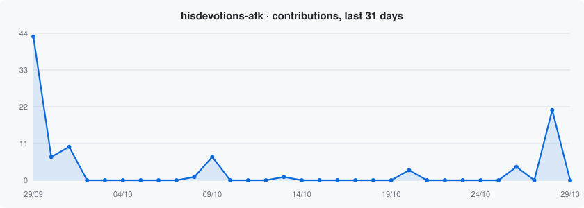

  <picture>
    <source media="(prefers-color-scheme: dark)" srcset="assets/banner-dark.png">
    
  </picture>

<h1 align="center">Hi 👋, I'm Roberto</h1>

<h3 align="center">AI Engineer</h3>

  

Putting LLM agents into production and staying with them from architecture to operations.

---

<h2 align="center">🚀 About Me</h2>

<picture>
  <source media="(prefers-color-scheme: dark)" srcset="assets/portrait-dark.png">
  
</picture>

**Roberto** here, an AI engineer based in São Paulo.

I'm also the founder of **[Cicada](https://www.linkedin.com/company/cicada-ai/)**, where we build AI operating systems for companies on top of the systems they already use. That means internal applications, integrations and data pipelines, LLM agents working inside operational workflows, and dashboards that help teams decide and plan. We start from the bottlenecks between people, processes, data and technology, and the goal is an operation that can be measured and audited.

I build agents and LLM systems that real people use. That includes LangChain agents on WhatsApp with memory per conversation, MCP servers that give agents access to databases, repositories and documentation, and flows where a person approves sensitive actions or takes over when the agent does not know the answer.

I run several LLM providers side by side with automatic fallback, and I compare models against each other, prompt injection tests included. Day to day I write **Python (FastAPI, async PostgreSQL, Celery)** and **TypeScript**, and ship with **Docker, CI/CD and automated tests**.

Before AI I worked in marketing and growth. I kept the habit of starting from the business problem and deciding up front how the result will be measured.

 

---

<h2 align="center">🤝 Connect</h2>

  &nbsp;
  &nbsp;
  

---

<h2 align="center">💻 Tech Stack</h2>

  

  

---

<h2 align="center">📊 GitHub Stats</h2>

  <picture>
    <source media="(prefers-color-scheme: dark)" srcset="https://streak-stats.demolab.com?user=hisdevotions-afk&theme=github-dark-blue&hide_border=true">
    
  </picture>

---

<h2 align="center">📈 Activity Graph</h2>

  <picture>
    <source media="(prefers-color-scheme: dark)" srcset="assets/activity-dark.svg">
    
  </picture>

